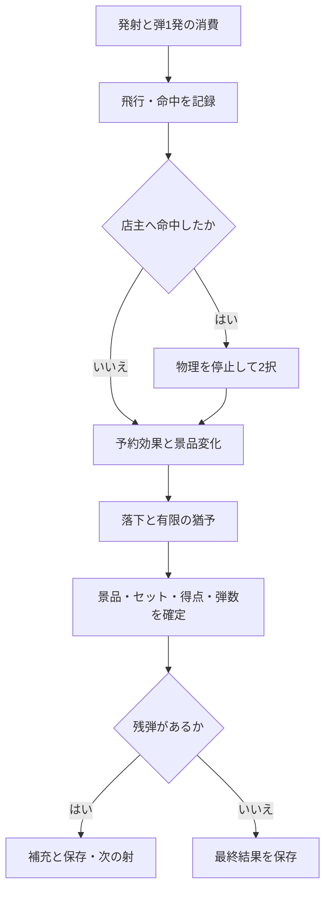

# シャテッキ 要件修正書 — 2景品セット・店主の質問・36枠・背景マス

文書版：1.0／作成日：2026年11月6日。対象：`chameleonjp-lab/shatekki`。

基準main：`78c29eb7cfebddbd8899c6c8ca178704ee3eddfa`（PR #15取り込み後）。この修正書は、利用者が同日に依頼した4つの変更と、実装前に確認する具体案をまとめる。今回のPRは文書のみであり、実装や公開の完了報告ではない。

## 1. 今回の変更と読み方

| 決定 | 利用者が指定した変更 | 本書で用意する内容 |
|---|---|---|
| D34 | 異なる2つの景品で成立する「〇〇セット」を300種類用意する。 | 既存景品100種類を参照する300組の候補表、成立・加点・図鑑の条件。 |
| D35 | 店主を撃つと200パターンからランダムで質問を表示し、2択の回答に応じてランダム効果を発生させる。 | 質問200件・選択肢400件・効果の抽選先、質問の表示時点、重複防止。 |
| D36 | 景品の並びを縦×横＝3×3から3×12に変更する。 | 縦3段・横12列、合計36枠の配置・補充・iPhone縦画面での操作条件。 |
| D37 | 景品の背景をマス目状にし、各マスで1ゲームに1回、100種類からランダムな効果を1つ発揮させる。 | 景品枠に対応する36マスの案、効果100件、使用済み管理と保存条件。 |

上の4点は今回の依頼事項である。以下の「提案」は、指定されていない細部をレビュー可能にするため本書で補った設計であり、すでに利用者が個別採用した内容とは扱わない。具体的な名称・文面・効果値も提案である。既存の正式値を記録した [rules-v1](../../data/release-approved-v1.json) は変更しない。

### 1.1 本書で採る提案

| 番号 | 提案 | 理由・判断が変わる場合の影響 |
|---|---|---|
| P01 | 既存の3景品セット100組を残し、2景品セット300組を追加する。合計400組。 | 既存セットを廃止する指定はないため、発見記録を保つ。置換を希望する場合は総数・図鑑・移行条件を変更する。 |
| P02 | セットとは別に、景品をまとめる20の「シリーズ」を用意する。 | 品揃え変更と縁表示の対象を明確にする。シリーズ内の全景品を集めても、それだけでセット加点はしない。 |
| P03 | 背景は棚の36枠と一対一の36マス。弾が背景の面へ実際に命中した時だけ発動する。 | 景品を落としただけ、景品が背景へ触れただけでは発動しない。景品の後ろを狙う遊びを追加する。 |
| P04 | 店主への命中は一射につき1問にまとめ、飛行が終わった後に質問を出す。 | 元弾・分裂弾・複数部位への命中で質問画面が連続しすぎることを避ける。次の射で再命中すれば新しい質問を出す。 |
| P05 | 100効果の表を背景マスと店主の回答で共用する。回答ごとに抽選できる範囲を変える。 | 選択の意味を残し、同じ効果を発生源ごとに別仕様へしない。 |

一射とは、1回の発射と、そこから生じた反射・分裂・景品変化・落下・質問への回答・結果確定までを指す。質問を加えた後も、1回の発射で弾を消費する回数は1回のままである。

### 1.2 読む順番と付録

本書が変更の本文である。[2景品セット300組](2026-11-06-pair-sets-300.md)、[店主の質問200件](2026-11-06-shopkeeper-questions-200.md)、[シリーズと効果100件](2026-11-06-effects-100.md)が具体的な候補を示す。文書内の識別子はレビューと実装時の対応付けに用いる。既存サーバーの識別値を意味しない。

本書と旧仕様が衝突する箇所は、D34〜D37の指定内容を優先し、提案部分は提案として扱う。ここにない既存の仕様は引き継ぐ。古い実装計画の「9枠」「全セット3種類」を、そのまま新実装へコピーしない。

## 2. 現在の実装との差分

| 対象 | 基準版で確認できた状態 | 今回の要求・影響 |
|---|---|---|
| 棚 | 正式値の `shelfSlotCount` は9。配置・描画・抽選目標も9枠を前提とする。 | 36枠へ拡張し、棚・壁・回収面・視点移動・射程・補充判定を同じ配置データへ合わせる。 |
| セット | 正式データは3種類×100組。成立判定自体は必要景品を走査するが、型と候補検査は3種類固定。 | 2種類と3種類の両方を扱う。件数・一意性・図鑑・翻訳・保存検査まで修正する。 |
| 店主 | 部位ごとの初回加点と命中演出がある。質問の段階はない。 | 質問待ちと回答処理を追加する。部位初回加点と、質問を出した回数は別に記録する。 |
| 背景 | 6系統の特殊装置があり、装置ごとに一射1回。 | 36マスは「一ゲーム1回」で別管理する。既存装置を置き換える指定はないため、本案では併存する。 |
| 保存 | 発射済みの印が残ると中断。射撃間の状態から復帰する。 | マス・質問・効果の状態を追加し、質問中の読み直しも未確定の一射として中断する。 |
| 公開と記録 | 正式名はシャテッキ／Shatekki。初回公開はランキング非公開・実験場未連携という条件。 | 同条件を維持する。変更後のルールを旧 `rules-v1` の記録へ混ぜない。 |

根拠：[正式公開の記録](../release/official-v1.md)、[正式データ](../../data/release-approved-v1.json)、[セットの型](../../src/contracts/catalog.ts)、[成立判定](../../src/catalog/sets.ts)、[配置](../../src/contracts/layout.ts)、[一射の処理](../architecture/shot-pipeline.md)、[保存の設計](../architecture/persistence-design.md)。旧要件の「未実装」「正式値未採用」という記載を、現在の実装状態の根拠には使わない。

## 3. 2景品セット300種類

異なる景品の種類を2つ、各1個獲得すると成立する。棚から所定の回収位置へ落ちて獲得した景品だけを数え、棚にあるだけの景品や、命中しただけの景品は含めない。1回の射撃で2つとも落とす必要はなく、同じゲーム内の累計でよい。

セットの景品は消費しない。同じ獲得実績を複数の2景品セットと既存の3景品セットへ利用できる。2景品セットと3景品セットが同じ射で成立した場合は、成立したそれぞれを1回ずつ加点する。どのセットも1ゲームにつき1回までで、別のゲームでは取り直せば加点できる。

| 項目 | 条件 |
|---|---|
| 件数と識別 | `PAIR001`〜`PAIR300` の300件。既存の `S001`〜`S100` を改名・再利用しない。 |
| 組み合わせ | 存在する異なる2種類、各1個。並び順が逆なだけの組は同じ組とみなして重複させない。 |
| 収集状態 | 種類ごとの獲得履歴を使う。同種2個は2種類の代わりにならない。景品変化後は、実際に獲得した時の種類を記録する。 |
| 図鑑 | 「2景品」「3景品」で絞り込める。未発見名を伏せる既存方針を維持し、必要数は明示する。発見済みの旧100組は保持する。 |
| 点数の提案 | 新しい2景品セットは試作用50点、既存3景品セットは正式値の100点を維持する。50点は未採用の調整案であり、成立数・点数分布を測った上で正式化する。 |

300組の名称・構成は付録でレビューする。100種類すべての景品を少なくとも1組に含める。名前だけ違って同じ組み合わせのセット、単に番号を付け替えた候補は認めない。付録のテーマ説明は制作者向けであり、未発見セットのヒントとしてそのまま全条件を公開しない。

## 4. 棚を縦3段・横12列へ広げる

棚は36の固定枠を持つ。行は上から1〜3、列は左から1〜12として、枠の番号を `slot-r1-c01` のように付ける。新規ゲームは36個を配置する。補充を延期している間だけ36個未満を認め、枠が塞がっている場合に未獲得景品を削除・移動して数を合わせない。

### 4.1 iPhone縦画面での見せ方の提案

屋台全体を一つの連続した空間として扱い、画面では3列程度を基本の大きさとして見る。位置選びの段階で左右の操作により連続して移動し、12列の端まで狙えるようにする。位置を決める操作と照準を動かす操作は分ける。照準や装填中の画面移動で、装填結果を引き直せない。

全体の3×12の小さな案内図を表示し、現在見ている範囲、景品の有無、背景マスの未使用・使用済みを示す。案内図を押しただけで発射・効果発動はしない。全景品や説明を小さくして36個を一画面へ押し込まない。

画面外にある景品・弾・背景マスも同じ一射で処理する。4つの独立した9枠の面に分けたり、見ている範囲だけを補充・計算したりしない。横向きでは既存どおり停止して縦向きの案内を出す。iPhone Safariの実機で両端・上下段・店主・操作欄が使えることを確認する。

### 4.2 配置・抽選・負荷

36枠に対して、屋台の左右幅、店主の位置、天井・側壁・背面、画面外でも有効な範囲、回収位置、視点の移動限界を一緒に見直す。弾や景品の当たり判定だけを9枠の幅に残さない。元の位置と当たり判定を動かさず、見た目だけで棚を横へずらす方法も使わない。

通常の景品抽選は既存の重複抑制を引き継ぐ。36枠の難易度目標は、旧3・4・2を4倍した「落としやすい12・普通16・難しい8」を試作用の提案とする。シリーズ指定中は該当シリーズ内で抽選し、存在しない難易度を無理に補わない。系列外の景品を黙って混ぜず、シリーズ内の重みを正規化する。

景品36個・背景36マス・既存装置・店主・最大分裂・縁表示を同時に使った負荷を測る。描画を省く場合も、画面外の衝突・獲得・効果・保存は省かない。フレーム落ちを理由に物理計算の刻みや採点を変えない。

## 5. 店主の質問200パターン

### 5.1 出題と回答

コルクが店主の有効な部位へ命中した射で質問を予約する。元弾と分裂弾、反射による再命中、複数部位への命中をまとめて一射1問とする。景品が店主へ触れた場合や、効果の処理で店主が動いた場合には出題しない。既存の部位ごとの初回加点はそのまま行い、質問を出したこと自体で追加の店主点を発生させない。

飛行が終わりコルクがなくなった時点で物理を止め、店主の質問を表示する。射撃中の画面に質問を割り込ませて操作を奪わない。落下中の景品があっても質問中は停止し、回答後に続きから動かす。

質問は200件の順序をゲーム開始時に無作為に並べたものから取り出す提案とする。1ゲーム内では同じ質問を繰り返さない。初期10発・追加累計10発の上限を維持するため、最大20射でも200件を使い切らない。新しいゲームでは再抽選する。

2択は正解当てではない。選択肢の近くに「弾の強化」「良い効果・悪い効果のどちらもあり」「品揃え変更」「シリーズを見つける」など、抽選範囲が分かる短い説明を付ける。Aが常に得、Bが常に損という配置にせず、左右で結果を決めない。

回答時間の制限や自動回答は設けない。一度どちらかを押したら両ボタンを無効にし、同じ質問の回答を再処理しない。演出省略でも回答は省略しない。途中でホームへ戻る場合は通常の中断として扱い、回答を取り消して同じ射をやり直すことはできない。

### 5.2 回答と効果の関係

付録の各選択肢には、抽選できる効果のグループを割り当てる。両選択肢に同じ登録候補集合を設定しない。適用できない効果を除いた結果、一時的に候補集合が同じになる場合や、異なる選択から同じ効果が出る場合はある。質問だけを変えても、抽選先の違いがあればどちらを選ぶかに意味がある。

回答を受け付けた時点で、そのグループの適用可能な効果から1件を等確率で選ぶ提案とする。選んだ効果の番号・対象・値・回答番号を確定し、表示のやり直しで再抽選しない。適用可能な候補が0件の場合は「今は使える効果がありません」と示して処理済みにする。別のグループへ黙って変更したり、成功するまで抽選を繰り返したりしない。

弾数が0になった最後の射でも、予約された質問は終了判定より先に表示する。回答による追加弾が上限内で得られれば続行できる。次の一射だけに効く強化を得ても、弾数が0ならゲームは終了し、強化を理由に弾を自動追加しない。

## 6. 背景マスと100種類の効果

### 6.1 マスの割当と発動

景品枠の背後に対応する36マスを置き、番号を `cell-r1-c01` のように固定する。新規ゲームの開始時に、各マスへ100件から1件を等確率で独立に割り当てる提案とする。別マスに同じ効果が割り当たることは許す。100種類の効果を毎ゲームすべて出す仕様ではない。

割当結果はゲーム開始状態とともに保存する。未使用マスは未使用であることを表示し、具体的な効果名は命中するまで隠す提案とする。コルクが背景の実際の面に接触した時に、そのマスを使用済みにして効果を1件予約する。景品を透過して奥のマスへ命中扱いにしない。マス境界への同時接触は接触位置と固定番号で一意に選び、同じ接触から2マスを発動させない。

一度使用したマスは、同じ射の分裂弾、後の射、景品補充、品揃え変更、画面外からの再接触でも再使用できない。通常の反射は残す。使用済みは暗さと記号で示し、色だけに頼らない。新しいゲームを始めた時にのみ未使用へ戻す。

### 6.2 効果の共通規則

| 項目 | 条件 |
|---|---|
| 発動時点 | 新しい100効果は飛行中に弾道を書き換えず、飛行終了後の処理点へ予約する。既存の分裂板・威力板の飛行中の動作は維持する。 |
| 次射の弾 | 弾の性質を変える効果は次の一射だけ。元弾とその分裂弾へ同じ設定を引き継ぎ、その一射が終われば解除する。同じ項目への複数効果は後の指定を使い、倍率を無限に積み重ねない。 |
| 弾数 | 正の追加は全発生源で累計10発を共有する。減少は0未満にしない。FX021〜023では残弾が2発以上の時だけ減らし、1発を残す提案とする。すでに0発の状態を1発へ戻さない。減少しても過去の追加累計を減らさず、初期10発と合わせた発射機会の上限20回を守る。 |
| 効果の上限 | 反射・分裂・同時弾数・威力・飛行時間・落下猶予を有限に保つ。100効果から別の効果や別の質問を再帰的に発動させない。 |
| 効果が使えない場合 | 背景に割当済みの効果を、都合のよい別効果へ引き直さない。上限・対象なし等の理由を表示してそのマスは使用済みにする。 |

飛行に使った効果と、その射で新しく予約した次射の効果は別に保持する。射の終了で解除するのは飛行に使った分だけで、新しい予約を一緒に消してはいけない。

同じ効果が別マスに割り当たっていた場合は、マスごとに1回発動できる。ただし、各効果の上限と上書き規則は共通である。「効果番号ごとに一ゲーム1回」と誤解して、別マスの使用を禁止しない。

## 7. シリーズによる品揃え変更と縁表示

シリーズとは、景品をテーマでまとめたグループを指す。20シリーズの番号と対象景品は効果付録で定義する。一つの景品が複数シリーズに属してよい。セットは獲得による加点条件、シリーズは配置・表示を選ぶ条件であり、互いの番号を流用しない。

### 7.1 品揃え変更の提案

シリーズを指定する効果が選ばれたら、棚に残る未獲得の景品をそのシリーズ内の種類へ変更する。見ている3列だけでなく36枠全体を対象にする。以後の補充も同じシリーズから抽選し、別の品揃え変更またはゲーム終了まで続く。

変更は弾の飛行後、得点確定前に行う。獲得済み景品は戻さず、現在の個体番号・所属枠・位置・向き・速度・角速度と、耐久値の残り割合を引き継ぐ。耐久値の割合を新しい最大値に掛ける丸め方は、現行の四捨五入を引き継ぐ提案とする。0だった耐久値を満タンに戻さない。種類が変わっただけでは獲得点やセット点は加点しない。

台に固定された周期運動中の個体は固定状態と周期の位相を維持し、外れた個体を台へ戻さない。新しい種類の周期運動は、新規補充時から適用する提案とする。形と質量は変化後の種類へ更新し、その結果の落下も同じ一射の獲得へ含める。

変更後の形が棚や他景品に重なる場合は、勝手な削除・位置移動で解消しない。重なりを避けられるシリーズ内の候補を選び、候補がなければその個体だけ変更を延期する。延期対象は個体番号で保存し、次の安全な一射終了処理で再確認する。既に回収された個体を後から変化させない。延期中の旧種類が一時的に残ることを案内する。

種類の候補順は、その効果を最初に処理する時に一度だけ抽選して固定する。個体は所属枠の行・列・個体番号順に調べ、既に採用した変更後の形と、まだ処理していない個体の現在の形に対して重なりを確認する。固定した候補順で最初に適合する種類を採り、適合しなければ候補順ごと延期する。次の射で再確認する時は抽選をし直さず、同じ順で新しい位置関係を調べる。通常の接触を許す範囲と、重なりとして拒否する範囲は物理側で共通に定義し、描画だけで判定しない。

延期後に実際に種類を変える時は、その時点の現在耐久値の割合を使う。予約時の古い割合へ戻して、その後の射で受けた傷を回復させない。同じ処理点の中で複数の変化がある場合だけ、最初の変化前の割合から一度丸める。延期予約は各個体につき最終の1件だけを持ち、新しい有効な指定で上書きし、獲得された個体の予約は取り除く。

同じ一射で複数の品揃え変更があれば、最後のシリーズが以後の補充先となる。個体に対する最終種類を決めてから形を1回更新し、繰り返しの丸めや中間の形で獲得を起こさない。

FX090〜092の個別の種類変更は、指定した未獲得個体だけへ作用し、以後の補充シリーズは変更しない。種類を元へ戻す効果も、配置時の種類だけを参照し、耐久値や得点を過去へ戻さない。品揃えシリーズと異なる種類になる場合は、その一時的な例外を効果結果に示す。

### 7.2 同色の縁で示す提案

指定したシリーズに属する棚上の景品すべてを、同じ色の縁と共通記号で示す。画面外の景品、新しく補充した景品、種類が変わった景品にも所属に応じて反映する。色と記号の対応表、対象シリーズ名を表示する。景品の体全体を塗り替えたり、点滅だけで意味を伝えたりしない。

縁表示でセット成立や景品獲得は起こさない。複数の指示は最後の一つへ切り替える提案とし、品揃えのシリーズと表示するシリーズは別々に保持する。対象が棚にない場合は「対象の景品は今はありません」と示す。縁表示は次の表示変更またはゲーム終了で解除する。

## 8. 一射の順序と同時発生

飛行中の接触には、物理計算の時刻、同時接触内の順序、対象番号を記録する。旧装置と背景マスの予約効果はこの安定した順で処理し、店主の回答効果はその後に1件追加する。描画の速さ、画面内外、演出省略によって順序を変えない。同じ効果要求に固有番号を付け、再処理でも一度しか適用しない。

質問の表示前には、弾数・残り追加枠・効果対象の判定に必要な先行効果を計算上で反映する。ただし、景品を物理世界へ反映して落下を進めるのは回答後の一度だけとする。回答候補の適用可能性は、先行する弾数処理などを反映した状態から決める。ただし、背景から既に予約した次射の弾設定や追加案内は、質問の回答を含む全ての弾数処理が終わるまで保留し、途中の残弾0だけで捨てない。最後の弾で強化を予約した後に回答で1発増えた場合、その強化を次射へ引き継ぐ。最終的にも残弾0なら予約を終了する。 先行効果は作業用の状態へ一度だけ仮適用し、効果の番号、対象個体、種類の候補順、決まった数値、進んだ乱数状態を計画として固定する。回答後はその計画へ回答の1件を追加し、先行部分の抽選や弾数の加減を再実行しない。回答で変化計画が上書きされた場合は新しい要求の候補順を使い、各要求の抽選は一度きりにする。最終的な形の適合確認は回答後の計画全体に対して行う。持ち越した景品変化の再確認は、その射の新しい予約効果より先に仮計算し、同じ個体への後の有効な指定で上書きする。

弾数の加減は予約順に適用し、追加のたびに累計上限を確認する。例として、追加累計9発で「+2」を得た場合は1発だけ増やす。その後に弾が減っても、追加累計は10発のままにする。

景品変化は、同じ個体へ予約された最後の有効な種類を使い、その処理点で最初に変化する前の耐久率から1回だけ計算する。新しい効果からさらに質問やマスの発動を起こさない。変化・回答が終わってから落下を処理し、その射の獲得とセットを一度に確定する。追加弾を処理する前にゲーム終了を決めない。

質問待ちは利用者の入力待ちなので時間制限を設けないが、回答後の物理処理は既存の有限上限内で完了させる。質問していた時間を落下猶予へ加算しない。

## 9. 保存・読み直し・旧版との関係

| 保存対象 | 内容 |
|---|---|
| 36マス | 各マスの効果割当、使用済み、発動した射、処理済み効果番号。 |
| 質問 | 質問の抽選順・使用位置、今回の予約質問、回答、確定した効果と対象。 |
| 継続効果 | 飛行に適用中の弾設定と次射に予約した設定の区別、品揃えシリーズ、縁表示シリーズ、延期した個体変化、次射だけの追加案内。 |
| 既存状態 | 36枠の棚・補充延期、各個体の新規配置/補充時の種類と現在の種類、弾数と追加累計、獲得、2種類・3種類の成立、得点、抽選状態。 |

射撃間の保存から再開した場合は、同じ棚・マス割当・質問抽選順・次射の効果を再現する。再開による再抽選はしない。質問表示中や回答効果の処理途中は、まだ一射の確定前である。ページが失われた場合は既存D27に従って中断し、質問や射撃をやり直させない。終了結果を送信せず、過去の自己ベストと図鑑は保持する。

ページが残ったままのアプリ切替・横向き・手動停止は、中断とは別である。同じ質問と選択状態を保持し、復帰後のタップを自動回答や誤射として扱わない。回答確定前後の二重タップ、戻る操作、複数タブからの操作でも、同じ効果を重ねない。

変更後の内容は `rules-v2-proposed` など旧版と異なる版で試作する提案とする。正式名は実装時の版管理へ合わせるが、既存 `rules-v1` のスナップショットを上書きしてはいけない。旧版の進行中プレイを36枠へ黙って変換しない。復元できない途中経過は保存して退避し、新規プレイとして案内する。

旧自己ベストと図鑑は消さない。採点条件が違うため、自己ベストはルール版ごとに区別し、旧記録を新ルールの記録として比較しない。既存セットの番号を保ち、図鑑の旧100組の発見状態は引き継ぐ。古い送信待ち、名前、言語、音設定も削除・初期化しない。

## 10. 表示・翻訳・音

既存の15言語方針を引き継ぎ、追加300セットの名称とヒント、200質問・400選択肢、効果名と結果説明、20シリーズ名、マス状態、上限・対象なし・中断の案内まで翻訳対象にする。付録は日本語の原稿案であり、15言語の翻訳完了を意味しない。文言の翻訳で景品番号、選択先、抽選確率や結果を変えない。

質問画面は長い文面でも2択を読めて押せるようにする。必要なら質問部分をスクロールさせ、回答ボタンが画面外へ消えたままにならない。ホームや再開の操作が回答の下へ重なって誤反応しないことを確認する。

店主の出題、回答、良い効果・悪い効果、品揃え変更、縁表示、マス使用済みの短い音と表示を用意する。多数の効果が同じ射で出ても音を重ねすぎず、結果一覧で何が起きたかを確認できるようにする。消音・音量0・演出省略でもルールと回答操作は同じにする。

## 11. 実装の影響先と進める順序

| 段階 | 変更する内容 | 主な現行ファイル・担当 |
|---|---|---|
| M01 | 2種/3種セット、シリーズ、質問、効果、36マス、回答待ちの型とデータ検査を定義する。 | `src/contracts/`、`src/catalog/validate.ts`。共有型の担当が所有をまとめる。 |
| M02 | 36枠の配置・壁・範囲・補充・画面外判定を一致させる。 | `src/contracts/layout.ts`、`src/core/replenish.ts`、`src/catalog/draw.ts`、`src/sim/`。Game担当。 |
| M03 | 質問予約・抽選・効果順序・変化・採点・終了判定を組み込む。 | `src/core/`、`src/sim/world.ts`、`src/app/controller.ts`。Game担当。 |
| M04 | 保存の版分け・復元・中断・旧記録保全を更新する。 | `src/persistence/`、`src/core/session.ts`、`src/contracts/game.ts`。Game担当。 |
| M05 | 横へ広がる屋台、全体図、背景マス、質問、縁表示、図鑑、15言語、音を仕上げる。 | `src/view/`、`src/ui/`、`src/i18n/`、`src/audio/`。Visual/UI担当。 |
| M06 | 変更部分を確認し、セット成立数・効果の偏り・iPhone性能を測り、正式値候補を示す。 | `tests/` と `docs/qa/`。統合担当。 |

M01で共通の扱いを決めた後、M02とM05の画面準備は並行できる。M03とM04は同じ効果・保存の仕様を参照する。統合前に所有するファイルを決め、複数担当が共有型や起点を同時編集しない。

既存の実装計画Task 03・05・06・08〜10・12〜17に影響する。過去の完了記録を消さず、今回のM01〜M06として差分を管理する。今回のPRでは `src/`、既存データ、試験コード、公開用設定を変更しない。

### 11.1 点数・効果値を決める測定

同じ試験条件で旧版と新案を比較し、獲得景品の種類数、2景品/3景品セット成立数、得点内訳、質問回数、良い効果/悪い効果/対象なしの回数、追加弾の累計、総プレイ時間を記録する。300組に増やすだけで楽しくなる、セットが必ず出るとは断定しない。

50点のセット加点、36枠の難易度目標、各効果の倍率は測定前の提案である。正式採用前に、セットだけが得点を占めすぎないこと、店主だけを狙う行動が無限に弾を増やさないこと、負の効果で操作不能にならないことを確認する。

## 12. 変更後の確認条件

以下は実装後の確認条件であり、今回の文書作成でゲームが合格したという意味ではない。旧AC01・AC02・AC20は下表で読み替え、旧AC11・AC17・AC18・AC25・AC35〜45は今回の機能を含めて再確認する。

| ID | 確認すること |
|---|---|
| CH-AC01 | 新規ゲームが縦3段・横12列の36個で始まり、36の固有枠番号を持つ。 |
| CH-AC02 | 棚・壁・回収面・有効範囲・描画が一致し、左右端と上下段を狙える。 |
| CH-AC03 | iPhone縦画面で位置移動と照準が混同せず、全体図から発射や効果が発生しない。 |
| CH-AC04 | 視点外の景品・マス・弾も処理され、同じ射の結果は視点で変わらない。 |
| CH-AC05 | 補充を36枠全体で行い、塞がった枠は延期し、未獲得景品を消去・移動しない。 |
| CH-AC06 | PAIR001〜PAIR300が300件あり、各2種類は実在し、順序無視の重複がなく全100種類を参照する。 |
| CH-AC07 | 既存S001〜S100を保ち、2種類300組＋3種類100組を区別できる。 |
| CH-AC08 | 異なる2種類を別々の射で獲得しても成立し、同種2個では成立しない。 |
| CH-AC09 | 2景品・3景品の同時成立と獲得の共用ができ、それぞれ一ゲーム1回だけ加点する。 |
| CH-AC10 | 新しいゲームでは成立状態を戻し、旧セットを含む発見記録を保持する。 |
| CH-AC11 | Q001〜Q200が200件あり、各2択、効果グループの参照漏れと同一の登録候補集合を持つ2択がない。 |
| CH-AC12 | 元弾・分裂弾・反射・複数部位で店主へ命中しても一射1問。別の射では再出題する。 |
| CH-AC13 | 同一ゲーム内で質問が重複せず、新しいゲームでは新たな抽選順を使う。 |
| CH-AC14 | 飛行中は質問を表示せず、質問中は弾・景品・周期運動・時間・落下猶予を停止する。 |
| CH-AC15 | 回答の二重タップや画面更新でも効果は1件で、選択したグループからのみ抽選する。 |
| CH-AC16 | 回答時間の制限・自動回答はなく、演出省略でも回答は必要。途中終了は中断になる。 |
| CH-AC17 | 店主の部位初回加点と質問回数が別管理され、質問だけで既存点を重複加算しない。 |
| CH-AC18 | SER01〜SER20の景品参照が有効で、シリーズ所属だけではセット加点しない。 |
| CH-AC19 | FX001〜FX100が100件で、各効果の対象・時点・終了・上書き・上限が定義されている。 |
| CH-AC20 | 背景36マスに1件ずつ割り当て、同効果の別マス割当を許し、再読み込みで引き直さない。 |
| CH-AC21 | 背景面への実際のコルク命中で発動し、景品越しの押下や景品の接触では発動しない。 |
| CH-AC22 | マス境界の1接触は1マスだけを選び、分裂弾の同時接触でも各マス1ゲーム1回を守る。 |
| CH-AC23 | 補充・品揃え変更・視点移動・後の射でも使用済みは戻らず、通常の反射は残る。 |
| CH-AC24 | 上限到達や対象なしでも割当済み効果を引き直さず、理由と使用済みを表示する。 |
| CH-AC25 | 追加弾は旧装置・背景・回答で累計10発を共有し、減少後も累計を減らさず最大20射を守る。 |
| CH-AC26 | 最後の射の質問で上限内の追加弾を得れば続行し、先に背景から予約した次射効果も保持する。追加枠がなければ説明の上で終了する。 |
| CH-AC27 | 次射だけの弾効果はその分裂弾にも引き継ぎ、終了後に解除。その射で得た新予約は消さない。同一項目は後勝ちで有限。 |
| CH-AC28 | 品揃え変更は未獲得だけを対象とし、画面外も含め個体番号・位置・速度・耐久率を維持する。 |
| CH-AC29 | 周期運動の固定状態と位相を維持し、外れた景品を台へ戻さない。新規補充は新種類の動きを使う。 |
| CH-AC30 | 形が重なる個体は変更を延期し、候補順を固定して再確認する。獲得済みを戻さず、延期後の現在耐久率を使い、旧種類の残存を案内する。 |
| CH-AC31 | 同一個体への複数変化で丸めを重ねず、変化後の落下を同一射の獲得・セットへ含める。 |
| CH-AC32 | 品揃えの補充先と縁表示の対象を別に保持し、上書き・終了時に正しく切り替える。 |
| CH-AC33 | 同シリーズの縁が同色・共通記号になり、補充・変化・画面外も追従する。色だけで区別しない。 |
| CH-AC34 | 同時効果の順序と乱数結果が保存・演出省略・描画速度で変わらず、質問前の仮計算を回答後に再抽選・再加算しない。 |
| CH-AC35 | 一射の全処理が終わる前に得点・セット・終了を確定しない。落下猶予を再延長しない。 |
| CH-AC36 | 射撃間の復元で36枠・マス使用済み・質問抽選順・次射効果・各シリーズを再現する。 |
| CH-AC37 | 質問中または回答処理途中でページが失われたら中断し、再質問・無料撃ち直し・終了送信をしない。 |
| CH-AC38 | アプリ切替・横向きから同じ質問へ戻れ、時間飛躍・自動回答・誤射がない。 |
| CH-AC39 | 保存失敗・複数タブでも旧保存を黙って上書きせず、二重効果や二重加点を起こさない。 |
| CH-AC40 | 旧ルールの自己ベスト・発見記録・名前・設定・送信待ちを保ち、異なる版の得点を混ぜない。 |
| CH-AC41 | 新文言を15言語で表示し、長い質問でも2択を操作できる。無音でも効果を理解できる。 |
| CH-AC42 | 36景品・36マス・最大分裂・縁表示・質問を含む負荷を測り、iPhone実機と模擬画面の証拠を分ける。 |
| CH-AC43 | 最後の弾→複数マス→店主質問→シリーズ変更→落下→2種/3種同時成立を、各一度だけ確定する。 |
| CH-AC44 | ランキング非公開・実験場未連携を維持し、新旧ルールのデータや公開設定を無断で変更しない。 |

## 13. このPRと後続実装の完了条件

このPRでは、4つの依頼が本文に反映され、300セット・200質問・100効果の候補を識別番号で照合でき、既存要件の読み替えと44件の確認条件がそろえば資料作成を完了とする。資料の件数・参照・重複・リンクを検査し、実装前のレビュー結果を記録する。

後続実装では、提案の採否と正式値を記録した上でM01〜M06を行い、該当する旧確認項目とCH-AC01〜44の結果を残す。自動試験だけでiPhone実機の操作・音・負荷を確認済みにしない。ゲーム公開やデータベース適用が完了したとも扱わない。

今回の差分は文書だけなので、[現行の確認範囲](../qa/ci-scope.md)に従い、文書の整合と変更範囲判定を確認する。コードを変えていないのに全ゲーム試験を繰り返すことはしない。後続で共有型・物理・採点・保存・正式データを変更する時には、現行の規則に従い全体の確認が必要になる。

## 14. 参照元

| 資料 | 用途 |
|---|---|
| [要件仕様書](../requirements.md)・[決定記録](../decision-log.md) | 既存の33決定と今回のD34〜D37。 |
| [正式公開の記録](../release/official-v1.md)・[正式データ](../../data/release-approved-v1.json) | rules-v1の採用値、ランキング非公開・実験場未連携の条件。 |
| [受入確認](../acceptance-criteria.md)・[証拠](../qa/acceptance-evidence.md) | 既存の確認項目と実行結果の区別。 |
| [景品候補](../../data/catalog-candidates.json)・[既存セット](../set-candidates.md) | 新しい候補の景品番号と既存S001〜S100。 |
| [一射の設計](../architecture/shot-pipeline.md)・[保存の設計](../architecture/persistence-design.md) | 反射・景品変化・結果確定・中断の既存の順序。 |
| [申し送り規約](../handoff/protocol.md) | 仕様管理、実装担当、レビュー、マージの区別。 |

実装状態の記述は冒頭の基準mainで確認した内容である。公開URLや実機動作の状態を、この文書だけで推定しない。
