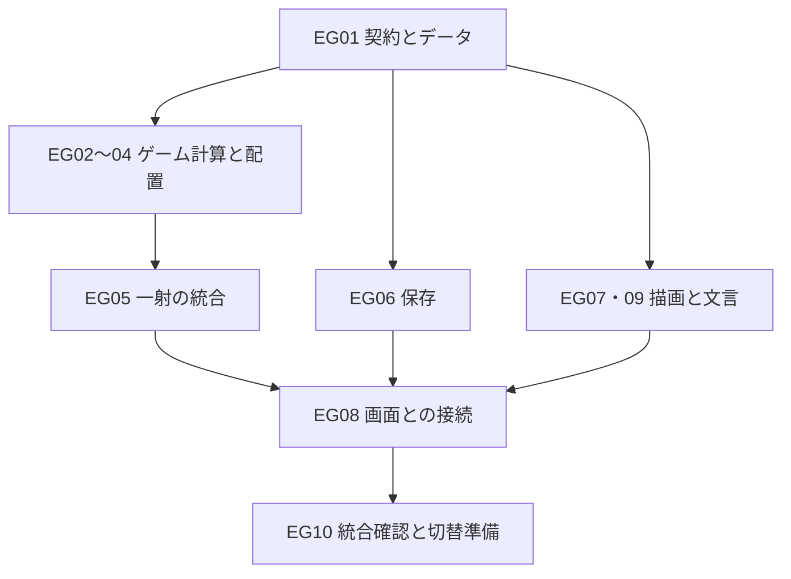

# シャテッキ 追加機能の実装計画書

> **実装担当へ：** 本書と修正書を一緒に読み、EG01〜EG10をチェック欄に沿って進める。利用可能な環境では `superpowers:subagent-driven-development` または `superpowers:executing-plans` を併用する。既存の担当・承認・申し送り規約を優先し、スキルや新しい実行環境の導入を追加の契約条件にしない。

**Goal（目的）：** 2景品セット300種、店主の200質問と2択、縦3段×横12列、背景マスごとの100効果を、旧記録を保ちながら追加する。

**Architecture（構成）：** 共通の型・実行設定を先に決め、景品・質問・効果を検査済みのデータとして読み込む。効果の計算と物理への反映を分け、飛行終了→質問→景品変化→落下→一射確定の順に接続する。描画・保存・翻訳は同じ状態を参照し、それぞれが抽選や得点計算を重複して行わない。

**Tech Stack（既存の開発環境）：** Node.js 22以上、TypeScript 5.9.3、Vite 8.3.4、Three.js 0.186.1、Rapier 0.21.0、Vitest 4.1.12、Playwright 1.63.0。根拠は[package.json](../../../package.json)。この計画のための依存追加・版更新は予定しない。

**Spec（基準仕様）：** [要件修正書](../../changes/2026-11-06-expanded-gameplay-requirements.md)、[300セット](../../changes/2026-11-06-pair-sets-300.md)、[200質問](../../changes/2026-11-06-shopkeeper-questions-200.md)、[100効果・20シリーズ](../../changes/2026-11-06-effects-100.md)。

文書版：1.0／2026-11-06。基準main：[`44b420467738f1f1ad5a72211260a6a05f52ca43`](https://github.com/chameleonjp-lab/shatekki/commit/44b420467738f1f1ad5a72211260a6a05f52ca43)。PR #16のマージを確認した時点の計画である。**EG01〜EG10はすべて未着手で、新機能の動作試験も未実施。** 旧Task 00〜18の完了記録を消さず、修正書M01〜M06の具体的な追加作業として扱う。

## Global Constraints — 全工程で守る条件

| 対象 | 条件 |
|---|---|
| 利用者指定 | D34：2景品300セット。D35：200質問・各2択・選択に応じたランダム効果。D36：縦3段×横12列。D37：背景マスごと1ゲーム1回・100効果。指定自体を未決定へ戻さない。 |
| 提案の扱い | 旧3景品100組の併存、300組の具体構成・50点、20シリーズ、1射1問、36背景マスへの実弾命中、抽選方式、効果値、難易度12/16/8は提案。C01〜C05の採否を記録し、採用済みへ自動で変更しない。本書の具体試験は修正書の提案を試作する場合の基準である。 |
| 弾数・時間 | 初期10発、全発生源の追加累計10発、最大20射。分裂2世代・同時8個、飛行4秒・静止待ち5秒・落下猶予1.2秒。質問の入力待ちは物理時間へ含めず、自動回答しない。各効果の数値上限は効果付録§3.2を共通に適用する。 |
| 旧装置との関係 | 旧特殊装置は装置ごと一射1回。新背景マスはマスごと一ゲーム1回。旧分裂・威力板の飛行中の作用と、新100効果の飛行後の作用を混同しない。 |
| 保存と記録 | `rules-v1` の正式スナップショットを変更しない。旧進行中プレイを36枠へ黙って変換せず、旧自己ベスト・図鑑・名前・設定・送信待ちを削除しない。質問中の再読込はD27の中断とする。 |
| 表示 | iPhone 17 Pro Safariの縦画面を中心とする。横向きは既存どおり停止。15言語は `ja/en/es/pt-BR/zh-Hans/fr/de/ko/ru/it/zh-Hant/id/tr/vi/th`。色と音だけに意味を持たせない。 |
| 公開条件 | ランキング非公開・実験場未連携を維持する。名前入力・ランキング表示と開始/終了/再送/取得通信を有効にしない。旧保存名と送信待ちはそのまま保管する。 |
| 作業と所有 | [CLAUDE.md](../../../CLAUDE.md)と[申し送り規約](../../handoff/protocol.md)に従う。共有型・起点・CIは統括が単独で編集する。main直push・AIによるマージ・Codex Cloud・無承認の外部設定/DB/費用変更を行わない。 |

## Review Focus — 特に見落としやすい5条件

| 条件と期待する結果 | 担当する試験 |
|---|---|
| 最後の弾で背景の次射強化を予約し、回答で1発増える。強化を途中の残弾0で捨てず、1発増える処理も一度だけにする。 | EG04・EG05：`shot-effect-plan.test.ts`、`expanded-shot.test.ts` |
| 変化を延期した景品が次の射で傷つく。古い耐久率へ戻して回復させず、候補の再抽選・Y座標補正も行わない。 | EG05：`expanded-transforms.test.ts` |
| 大きい時間差を渡したフレームで最後のコルクが消える。同じ呼出し内で質問待ちを越えて落下せず、復帰時に待機時間をまとめて消化しない。 | EG05：`controller.test.ts`、`expanded-shot.test.ts` |
| 版を持たない旧自己ベスト、保存容量不足、二つのタブがある。旧記録を新ルールの値と決めつけず、退避失敗後に元データを上書きしない。 | EG06：`profile-versions.test.ts`、`expanded-checkpoint.test.ts` |
| 長い翻訳の2択、画面端、縁の対象0個、音量0が重なる。両回答を操作でき、何が起きたかを文字で確認できる。 | EG07〜EG09：`expanded-gameplay.spec.ts`、`expanded-long-text.spec.ts` |

---

## 1. 基準実装から分かった変更箇所

以下は基準コミットで確認した事実である。「新設」と記すパス・型・関数は、この計画で提案する今後の実装先であり、現在存在するものではない。

| 現行の実装 | 追加実装で必要な対応 |
|---|---|
| `src/contracts/ids.ts` はS番号と9枠の `t0c0` 形式を検査し、`catalog.ts` はセットを3要素に固定する。`runtime-config.ts` も3要素を明示して組み立てる。 | 番号・型・組立・データ検査を一緒に2/3種類へ対応させる。旧100組の検査を300組の追記で壊さない。 |
| `src/app.ts` は正式カタログ・正式調整値・旧配置を直接読む。`CORE_RULES` は新規生成・確定処理へ配置を渡していない。 | 起動、生成、保存検査、物理、描画、補充へ同じ設定一式を渡す。試作の調整値だけ36に変えても足りない。 |
| `GameController` と `ShotWorld` は飛行終了後に変化・落下まで続け、最後の `ShotRecord` を一度確定する。 | 物理内部へ飛行終了の停止点を加え、回答後に再開する。質問画面の表示を見てから止める方法では間に合わない。 |
| `world.ts` の既存変化は固定中の個体を除外し、形の高さによってY座標を変える。周期運動は現在種類の設定を読む。 | 固定中も対象にし、姿勢と動作元を保つ。重なる形だけ延期し、位置をずらして解消しない。 |
| `session.ts` は `shotsFired + ammo === initialAmmo + bonusAmmoTotal` を検査する。 | 実際に減った弾の累計 `ammoLostTotal` を加え、新しい正常状態を不正扱いにしない。 |
| `profile-store.ts` の自己ベストは1個で、`recordRunEnd` はルール版を受け取らない。日本語のセット名・ヒントも旧100組が起点。 | 版ごとの自己ベスト、旧版不明値の保管、新300組の名前・ヒントの読込を別々に追加する。 |
| `.github/workflows/pages.yml` は、成功した最新mainのCI成果物を配信する定義になっている。文書のみで成果物がない時は配信を省略する。 | 「どの実装PRも公開されない」とは扱わない。途中の製品変更は既定のv1を保ち、最終の有効化を一つのPRへまとめる。公開URLへの到達はこの計画では未確認。 |

根拠：[型](../../../src/contracts/game.ts)、[識別子](../../../src/contracts/ids.ts)、[セット](../../../src/contracts/catalog.ts)、[カタログ組立](../../../src/catalog/runtime-config.ts)、[起点](../../../src/app.ts)、[Controller](../../../src/app/controller.ts)、[物理](../../../src/sim/world.ts)、[保存検査](../../../src/core/session.ts)、[自己ベスト](../../../src/persistence/profile-store.ts)、[Pages](../../../.github/workflows/pages.yml)。

## 2. 先に固定する受渡し

### 2.1 共通設定と型

EG01で次の名前・責務を定義する。後続工程で変更が必要なら、統括が影響する担当と試験をまとめて更新する。

| 型・配置先 | 定義する内容 |
|---|---|
| `GameplayBundle`／新 `src/contracts/expansion.ts` | `catalog: RuntimeCatalog`、`tuning: TuningConfig`、`layout: BoothLayout`、`expansion: ExpansionCatalog \| null`。旧版はnull、新案は検査済みの追加定義を持つ。`RulesContext` はこの内容を使う。 |
| `ExpansionCatalog`／同上 | 300組、200問×A/B、6効果グループ、100効果、20シリーズの定義と採用状態。各定義は固定IDを持つ。効果操作は弾数・弾設定・品揃え・縁・個別変化・追加案内に分け、任意のコード文字列を実行しない。 |
| IDとセット／`ids.ts`、`catalog.ts` | 既存S番号を維持しPAIR番号を追加。`requiredTypeIds` は異なる景品2個または3個の配列。`QuestionId`、`EffectId`、`EffectGroupId`、`SeriesId`、`BackgroundCellId`、`EffectRequestId` を区別する。書式だけでなく定義への所属を検査する。 |
| `ExpandedRunState`／`game.ts` | 新状態は保存形式2として、現行形式1と区別する。`ammoLostTotal`、`expansion` を追加。`expansion` はマス36件、質問順と位置、適用中/次射の設定、補充/縁の系列、延期変化、追加案内、乱数状態を持つ。共通関数で扱う `RunState` は旧/新の区別を型で検査できる形にする。 |
| 射の段階／`InFlightMarker`の新形式 | 新ルールでもトップレベルの `phase: 'resolving'` を保ち、`stage: 'flight' \| 'question' \| 'postEffects'` と、現在問・回答・`EffectPlan` を持つ。質問待ちを `pauseReasons` へ混ぜない。旧形式には質問段階を作らない。 |
| `ShotModifiers`／`expansion.ts` | 弾種、損傷/押す力/初速/重力/反発/揺れ/装填周期/半径/分裂角の倍率、追加反射数、発射個数1/2/3。付録の値と上書き規則を使う。発射時に元弾と分裂弾へ同じ値を固定し、その射で得る新予約と分ける。 |
| 配置／既存 `src/contracts/layout.ts` と新 `src/contracts/layout-v2.ts` | 既存 `SlotGeometry.column` の0〜2固定を12列へ対応させ、`BoothLayout` で旧9枠と新36枠を区別して検査する。新配置は上からr1〜r3・左からc01〜c12の36枠と一対一の背景面。`slot-r1-c01` / `cell-r1-c01` を使用。旧tierは0が下段なので `row = 3 - tier`、`column = oldColumn + 1`。旧保存をこの式で自動移行する用途には使わない。 |
| 個体と延期／`game.ts`、`sim.ts` | 配置時種類は既存 `drawnTypeId` を再利用する。固定運動の元設定・基準姿勢・位相を現在種類から分離して保持する。延期は個体ID・要求ID・固定候補順を持ち、古い耐久率を保存しない。 |

新規開始時だけ、景品抽選、マス割当、質問順、効果抽選の乱数状態を作る。既存の保存可能な乱数処理を使い、発生源ごとの状態を保存する。再描画・適用可能候補の列挙・延期の再確認では乱数を消費しない。旧ルールの抽選列は変更しない。

### 2.2 飛行後の停止点と計画

| 契約／担当 | 入出力と責務 |
|---|---|
| `FlightBarrier`／EG01・EG05 | `runId`、`shotId`、`barrierId`、接触要求、店主接触の有無、飛行中の獲得、現在の個体・速度・角速度・固定運動、物理経過時間を含む。`SimulationStep` に `barrier: FlightBarrier \| null` を追加する。停止点では最終recordを返さない。 |
| `EffectRequest`／EG01・EG03〜05 | 要求ID、旧装置/マス/回答/持越しの発生源、物理時刻・接触順・対象ID、操作またはFX番号を持つ。同時刻は接触順、さらに固定IDで一意に並べる。 |
| `EffectPlan`／EG04 | 停止点ID、処理済み要求、固定対象と候補順、乱数の次状態、弾・系列・次射設定などの仮計算結果 `projection` を持つ。確定前の得点台帳を書き換えない。回答後はこの同じ計画へ1件追加する。 |
| `ShotWorld.resumeAfterEffects(plan: EffectPlan): boolean`／EG05 | 対応する未処理停止点の計画だけを一度受理し、最終の形状計画を反映して落下へ進む。同じ計画・別射・別停止点は拒否する。形の検査に乱数を使わない。 |
| `ShotWorld.previewFirstContact(request: ShotRequest): AimPreview`／EG05・EG07 | FX098用の読み取り専用の予測。新 `AimPreview` は `points: readonly Vec3[]`、`firstHitTargetId: string \| null`、`approximate: true` を持つ。現在の場面と同じ弾設定で飛行4秒以内・最初の接触までを調べ、物理状態・乱数・接触要求・得点を変更しない。Controllerが結果を表示状態へ渡し、描画からゲームを進めない。 |
| `ANSWER_SHOPKEEPER`／EG01・EG08 | コマンドの項目は `type`、`shotId`、`questionId`、`choice: 'A' \| 'B'` のみ。余分な効果番号・倍率・点数・対象は `parseCommand` で拒否。現在問と一致し、未回答で、環境停止中でない時だけ受理する。 |

効果を一度しか確定しないことと、何度表示しても同じ結果になることを保証するため、以下の関数を提案する。型はEG01で上表に従って定義する。

```ts
// src/catalog/expanded-config.ts
export declare function buildExpandedCatalog(base: RuntimeCatalog, raw: unknown): ExpansionCatalog;
// src/catalog/gameplay-config.ts — 新設
export declare function getGameplayBundle(key: 'official-v1' | 'expanded-proposed'): GameplayBundle;
// src/core/effect-plan.ts — 新設
export declare function planFlightEnd(state: RunState, barrier: FlightBarrier, ctx: RulesContext): RunState;
export declare function answerShopkeeper(state: RunState, command: AnswerShopkeeperCommand, ctx: RulesContext): RunState;
// src/app/controller.ts の RulesApi の変更対象。既存の他のメソッドは残す。
interface RulesApi {
  createRun(config: RunConfig, ctx: RulesContext): RunState;
  resolveShot(state: RunState, record: ShotRecord, ctx: RulesContext): { state: RunState; summary: ShotSummary };
}
```

`AnswerShopkeeperCommand` は上表の回答コマンド型である。`RulesContext` は既存の配置先を保ち、`GameplayBundle` の4項目にそろえる。`buildExpandedCatalog` は旧景品100種を参照して追加定義を検査し、`getGameplayBundle` が旧カタログと追加セットを組み合わせる。前者だけで現行の正式データを書き換えない。

### 2.3 一射を確定する境界

持越し変化→物理接触順の旧装置/背景→回答1件、の順に計画する。旧分裂・威力は飛行中だけ処理し、旧追加弾・次弾種・変化など飛行後の操作を共通計画へ変換する。旧減点は採点台帳へ一度だけ残す。現在の `deviceEffects` と新計画で同じ追加弾を二度加算しない。

物理側は最後のコルクが消えた固定刻みで停止し、その呼出しの残り刻みも進めない。質問がない射も同じ計画経路を使う。質問中は物理・周期運動・時計・猶予を進めず、待った時間を次のフレームへ足さない。質問表示前に `finishShot` や `syncShelf` を呼んで速度を失わせない。

回答後に計画全体の形を確認し、行・列・個体ID順で最終種類を一度だけ適用する。変更済みの形と未処理の現在形を参照し、重なる個体だけ延期する。Y座標を含む姿勢・速度・角速度・耐久率・固定運動を保つ。延期後は実際に変える時の耐久率を使い、新しい有効要求で古い延期を上書きする。獲得個体の延期は取り除く。

`resolveShot` だけが仮計算結果と最終の物理結果から台帳・獲得・セット・残弾を確定する。保存検査の式は、新ルールについて `shotsFired + ammo + ammoLostTotal === initialAmmo + bonusAmmoTotal` とする。`ammoLostTotal` に入れるのは下限処理後の実減少数。質問前の残弾0で次射予約を捨てず、回答後も0の場合だけ終了させる。

## 3. ファイルの所有と並行作業

| 担当領域 | 主な変更先・新設先 | 所有の受渡し |
|---|---|---|
| 共通型・起点 | `src/contracts/`、`src/app.ts`、`src/app/controller.ts`、`src/app/rules.ts` | 統括が所有。EG01→EG05→EG08の順で接続する。 |
| データ・セット | 新 `data/expansion-v2/`、`src/catalog/`、`src/core/scoring.ts` | Game担当。旧正式JSONは読み取り専用。EG02の採点差分をEG05へ先に渡す。 |
| 配置・物理 | `src/sim/world.ts`、`src/core/replenish.ts`、新 `src/sim/transform-plan.ts` | Game担当。worldはEG03を確定してからEG05へ引き渡す。 |
| 質問・効果計算 | 新 `src/core/questions.ts`、`gameplay-effects.ts`、`effect-plan.ts`、`series.ts` | Game担当。DOMや物理世界を直接変更しない。 |
| 保存 | `src/core/session.ts`、`src/persistence/` | EG06担当。EG01の状態契約を使い、確定処理への配線は統括へ渡す。 |
| 描画・画面・文言・音 | `src/view/`、`src/ui/`、`src/i18n/`、`src/audio/` | Visual/UI担当。計算結果を表示し、初期化・採点・抽選を行わない。 |
| CI・測定 | `scripts/ci/plan.mjs`、`tests/ci/plan.test.mjs`、`docs/qa/` | 統括が所有。新しい画面試験も差分選択へ登録する。 |

EG01の契約が揃った後、Gameの計算、保存、Visual/UIの仮表示を並行できる。利用できる担当数に合わせて割り当て、同じファイルを同時編集しない。共有型の変更を待つ間は、翻訳原稿・データ検査・既存記録を使う保存試験を進める。



図の並列作業でも、EG07の実配置確認はEG03、EG09の図鑑確認はEG02、EG06の実際の復元確認はEG05の結果を使う。仮入力で先行できる作業と、実接続の完了を区別する。

## 4. 工程別の実装計画

各工程は「失敗する確認を追加→失敗理由を確認→最小実装→対象確認を通す→変更を記録」の5段階で進める。以下の試験名は追加・拡張予定であり、今回の文書PRで実行したコマンドではない。対象試験の成功件数は1件以上、失敗・skip・todoは0件を必要とする。共通型等の変更では、対象確認に加えて§5の全体CIを使う。

### EG01 — 契約・候補データ・共通実行設定

**対応：** M01。依存なし。統括＋Game。完了物は、旧版と新案を混ぜずに検査・取得できる設定一式。

**ファイル：** 新設 `src/contracts/expansion.ts`、`src/contracts/layout-v2.ts`、`src/catalog/expansion-validate.ts`、`src/catalog/expanded-config.ts`、`src/catalog/gameplay-config.ts`。新設データは `data/expansion-v2/pair-sets.json`、`questions.json`、`effects.json`、`series.json`、`profile.json`。変更は `src/contracts/ids.ts`、`layout.ts`、`catalog.ts`、`game.ts`、`sim.ts`、`events.ts`、`ports.ts`、`aim.ts`、`index.ts`、`src/catalog/runtime-config.ts` と共通設定のアダプター。`AimPreview` は `src/contracts/aim.ts` に定義する。試験は新 `tests/unit/expansion-catalog.test.ts` と既存 `contracts.test.ts`、`catalog.test.ts`、`release-config.test.ts`。

**受渡し：** §2の型と `getGameplayBundle` を後続へ渡す。追加定義の日本語・効果値は付録の識別番号と一対一に対応させ、値の採用状態も集計する。旧版だけ承認済みでも新案全体をapprovedにしない。

- [ ] 300組/600景品参照/100種の網羅、200問/400選択肢、100効果、20シリーズ、異なるA/B登録集合、有限値、旧JSONの不変を確認する試験を作る。逆順の同じペア、未定義ID、3要素へundefinedを混入、未承認効果だけapproved扱いを失敗例にする。
- [ ] `npm run test:unit -- tests/unit/expansion-catalog.test.ts tests/unit/contracts.test.ts tests/unit/release-config.test.ts` を実行し、新しい契約が未実装で失敗することを確認する。環境不備や既存の別障害を新要件の失敗と混ぜない。
- [ ] 付録を機械で読める定義へ写し、2/3要素の組立と版別検査を実装する。候補の理由文を未発見ヒントへそのまま公開しない。新案は例として `rules-v2-proposed-r001`・prototype、旧版は `rules-v1` のままとし、既定起動は旧版を保つ。点数・構成・効果・抽選条件や保存互換性を変える調整ごとに版を更新する。
- [ ] 同じ対象試験と `npm run typecheck` を通す。旧100組の検査を弱めず、全起動経路が同じbundleを受け取る契約試験を含める。
- [ ] `feat: add expanded gameplay contracts and catalog` を目安にコミットし、所有パス・契約・C01〜C05の状態を記録する。候補の採用判断が変わった部分だけを更新し、利用者指定の件数を減らさない。

### EG02 — 2景品セットの判定と加点

**対応：** M03。EG01に依存。Game担当。完了物は2種類・3種類の累計判定と一度だけの加点。

**ファイル：** `src/catalog/sets.ts`、`src/core/scoring.ts`、`src/core/settlement.ts`、必要な `src/core/result.ts`。新 `tests/unit/pair-sets.test.ts`、既存 `tests/unit/scoring.test.ts`。図鑑画面はEG09、永続保存はEG06へ渡す。

**受渡し：** 既存 `completedSetsFor` と確定時の `newlyCompletedSets` を再利用する。出力は既存S番号とPAIR番号を持つ `SetId`。シリーズ所属はセット判定の入力にしない。

- [ ] 「P001の同種2個ではPAIR未成立」「異なる2種類を別射で取ると成立」「同じ獲得で2/3種類が同時成立」「同一record再処理で追加点0」の試験を作る。点数は設定を読み、試作50点と旧100点の区別も検査する。
- [ ] `npm run test:unit -- tests/unit/pair-sets.test.ts tests/unit/scoring.test.ts` で、新しいペアの失敗を確認する。
- [ ] 配列を走査する既存判定を拡張し、獲得個体と種類を分ける。変化後に実際に獲得した種類を使い、1ゲーム1回・獲得共用・一射ごとの得点下限0を維持する。
- [ ] 同じ対象試験を通す。新規ゲームの成立状態は空、旧発見状態を消さないことをEG06へ渡す検査例にする。
- [ ] `feat: score pair sets alongside existing sets` を目安にコミットし、`settlement.ts` の所有をEG05へ引き渡す。

### EG03 — 36枠・背景接触・シリーズ内補充

**対応：** M02。EG01に依存。Game担当。完了物は36枠の同じ物理空間と、1ゲーム1回の背景命中要求。

**ファイル：** `src/contracts/layout-v2.ts`、`src/catalog/draw.ts`、`src/core/state.ts`、`src/core/replenish.ts`、`src/sim/world.ts`、`src/sim/collisions.ts`。新 `src/core/background-cells.ts`。新 `tests/unit/expanded-layout.test.ts`、`tests/unit/background-cells.test.ts`、既存 `draw.test.ts`、`replenish.test.ts`。

**受渡し：** 新配置と36マスの保存可能状態を渡す。各コルクの実接触は安定順の `EffectRequest` へ変換し、使用済みを景品個体ではなくマスIDへ結び付ける。シリーズ候補集合はEG04の補充系列を入力として受け取る。

- [ ] 36固有枠/36対応マス、上段r1と下段r3、左右端、景品で遮られた背景、境界1接触=1マス、分裂弾同時命中、次射でも再使用不可を試験にする。塞がった枠の延期と、対象シリーズ内に一つの難易度しかない補充も確認する。
- [ ] `npm run test:unit -- tests/unit/expanded-layout.test.ts tests/unit/background-cells.test.ts tests/unit/draw.test.ts tests/unit/replenish.test.ts` を実行し、旧9枠との差で失敗することを確認する。
- [ ] 棚・壁・回収面・有効範囲・店主/装置・移動範囲を同じ新配置へ合わせる。開始時に36マスへ独立にFXを割り当て、同FXの別マス重複は許す。補充は全36枠を扱い、シリーズ外を混ぜず、既存の重複抑制を候補内で正規化する。
- [ ] 同じ対象試験を通す。表示範囲を変えても命中要求と補充結果が同じこと、使用済みでも反射は残ることを確認する。難易度補正の内部上限 `MAX_DEFICIT` は根拠なく4倍にせず、EG10の測定対象へ記録する。
- [ ] `feat: add 36-slot layout and background contacts` を目安にコミットし、`world.ts` をEG05へ渡す。EG07はこの配置を描画で参照する。

### EG04 — 質問抽選と100効果の計算

**対応：** M03。EG01に依存し、EG03の接触契約を使う。Game担当。完了物は物理・画面に依存せず再現できる質問と効果計画。

**ファイル：** 新 `src/core/questions.ts`、`src/core/gameplay-effects.ts`、`src/core/effect-plan.ts`、`src/core/series.ts`。新 `tests/unit/shopkeeper-questions.test.ts`、`tests/unit/gameplay-effects.test.ts`、`tests/unit/shot-effect-plan.test.ts`。共有stateへの初期化接続は統括へ渡す。

**受渡し：** `planFlightEnd` と `answerShopkeeper` が未確定状態内の同じ `EffectPlan` を返す。200問の並べ替えから一射1問、選択先の適用可能集合から1件を等確率で選び、集合0なら理由付きで終了する。

- [ ] 全100効果の操作・値・終了・不適用を表から検査し、加算枠9で+2なら実追加1、残弾2で減少要求3なら実減少1、残弾0で減少しても0を確認する。二重回答、再表示、先行強化→最後の回答+1、activeとpendingの別管理を試験にする。
- [ ] `npm run test:unit -- tests/unit/shopkeeper-questions.test.ts tests/unit/gameplay-effects.test.ts tests/unit/shot-effect-plan.test.ts` で未実装の失敗を確認する。
- [ ] §2.3の順序でprojectionを計算する。選んだFX・対象・候補順・乱数の次状態を固定し、回答後に先行分を再実行しない。弾減少の実数を `ammoLostTotal` へ記録し、追加累計は減らさない。品揃え系列と縁系列、個別変化と補充先を別に扱う。
- [ ] 同じ対象試験を通す。全FXに処理担当があり未知操作を拒否すること、登録A/B集合が違っても適用可能集合が一時的に同じになる場合を許すこと、画面の関数から乱数が進まないことを確認する。
- [ ] `feat: plan shopkeeper answers and gameplay effects` を目安にコミットし、同じ停止点を使う入力/出力例をEG05・EG06・EG08へ渡す。

### EG05 — 飛行後停止・景品変化・一射確定

**対応：** M03。EG02〜EG04に依存。Game＋統括。完了物は最後の弾を含め、一射を一度だけ確定する実処理。

**ファイル：** `src/sim/world.ts`、`src/sim/prize.ts`、`src/sim/motion.ts`、`src/sim/shot.ts`、新 `src/sim/transform-plan.ts`。`src/core/transitions.ts`、`gimmicks.ts`、`settlement.ts`、`src/app/controller.ts`、`src/app/rules.ts`、`src/contracts/aim.ts`。新 `tests/unit/expanded-transforms.test.ts`、`tests/integration/expanded-shot.test.ts`、既存 `controller.test.ts`、`transform-grace.test.ts`、`aim-parity.test.ts`。

**受渡し：** `FlightBarrier` → `EffectPlan` → `resumeAfterEffects` → 最終 `ShotRecord` → `resolveShot`。新ルールだけ新経路へ入り、旧ルールの一射と正式値を維持する。描画と実弾は同じ発射時設定を受け取る。

- [ ] 1回の大きいdtでも停止点を越えない、回答待ち中の位置/位相/猶予が不変、同計画/recordの二重処理なし、最後の回答+1で続行を試験にする。延期後の追加ダメージ、固定中/外れた個体、Y位置不変、重なり、同処理点の複数変化を含める。
- [ ] `npm run test:unit -- tests/unit/expanded-transforms.test.ts tests/unit/controller.test.ts tests/unit/transform-grace.test.ts` と `npm run test:integration -- tests/integration/expanded-shot.test.ts tests/integration/aim-parity.test.ts` をそれぞれ実行し、未実装箇所の失敗を確認する。
- [ ] 物理内部で停止・一度だけ再開し、速度を消す前に変化を適用する。固定動作の元設定・基準姿勢・位相を残し、新種類の動作は新規補充から使う。弾の半径・初速・重力・分裂個数を照準/衝突/描画へ共通に渡す。旧追加弾と新計画を重ねず、落下後に獲得・セット・弾・終了を確定する。
- [ ] 同じ対象試験を通す。反射4〜10回、分裂2世代/8個、威力枠4倍、有限時間を守り、演出省略・異なる視点・描画頻度でも同一環境内の結果が一致することを確認する。端末をまたぐ完全な物理一致は新たに保証しない。
- [ ] `feat: resolve expanded shots through an answer barrier` を目安にコミットする。`onShotSettled` は図鑑・最終保存・結果表示の唯一の入口として残し、Controllerの所有をEG08へ渡す。

### EG06 — 保存・復元・ルール版ごとの自己ベスト

**対応：** M04。EG01から先行し、実結合はEG04・EG05後。Game担当。完了物は旧記録を残し、同じ抽選と棚で再開できる保存。

**ファイル：** `src/core/session.ts`、`src/persistence/run-store.ts`、`profile-store.ts`、`keys.ts`、`quarantine.ts`。新 `tests/unit/profile-versions.test.ts`、`tests/integration/expanded-checkpoint.test.ts`、`tests/e2e/expanded-reload.spec.ts`。既存checkpoint/reload試験も残す。

**受渡し：** `ProfileStore.recordRunEnd` は `Pick<FinalResult, 'status' | 'score' | 'rulesVersion'>` を受ける。新 `bestFor(rulesVersion: string): number | null` と、版別の `bestScores`、元版を特定できない `legacyBestScore` を定義する。旧ベストを根拠なくrules-v1へ分類しない。既存Sの発見は保持し、新PAIRの発見を併合する。

- [ ] 正常な弾減少後の保存、36マス/質問順/次射設定/延期の復元、質問中/回答中の再読込=中断を試験にする。旧bestScore、旧進行中、別タブ更新、JSON不正、読取/書込/退避失敗、移行再実行を固定データで確認する。
- [ ] `npm run test:unit -- tests/unit/profile-versions.test.ts` と `npm run test:integration -- tests/integration/expanded-checkpoint.test.ts tests/integration/checkpoint.test.ts` をそれぞれ実行し、旧処理で不足する条件を確認する。
- [ ] 旧キー `shatekki.run.v1` / `shatekki.profile.v1` を消さず、新形式は別キーへ書く。新runは版をキーへ含め、形式2として検査する。旧値は原文の保管と変換先の書込成功を確認し、失敗時は元データを維持する。旧アプリが後から書いた旧ベストと旧S発見も読込時に再併合し、新ルールの値を旧キーへ書かない。名前・設定・送信待ちのキーは変更しない。旧版へ戻しても新キーを削除しない。
- [ ] 同じ対象試験と、新規 `expanded-reload.spec.ts` を§5のブラウザ確認手順で通す。射間だけ復元でき、inFlightを持つ質問中は中断・送信なしとなることを確認する。複数タブは少なくとも同一保存先への書込競合を検出し、古い状態で上書き・二重確定しない。
- [ ] `feat: preserve legacy records across expanded gameplay saves` を目安にコミットする。起点の自己ベスト取得・新規開始・復元・結果表示の変更をEG08へ渡す。

### EG07 — 36枠の見せ方・全体図・シリーズの縁

**対応：** M05。EG01で先行、EG03の実配置とEG04の表示状態で完了。Visual担当。完了物は両端まで狙える縦画面と、意味の分かるマス/縁表示。

**ファイル：** `src/view/booth.ts`、`camera.ts`、`scene.ts`、`prizes.ts`、`offscreen.ts`、`hud.ts`、`aim.ts`、`effects.ts`、新 `src/view/background-cells.ts`、`src/view/series-outline.ts`、`src/view/gameplay-hints.ts`。`src/ui/controls/model.ts`、`panel.ts`、`controls.css`、新 `src/ui/booth-map.ts`。新 `tests/integration/expanded-view-contract.test.ts`、`tests/e2e/expanded-gameplay.spec.ts`。

**受渡し：** `SimulationFrame` と `ViewState` の検査済み状態だけを読む。全体図は位置・空き・使用済みを表示し、発射/FX要求を生成しない。位置選びは既存 `SET_POSITION`、照準は `AIM` を使い分ける。FX093〜100の耐久率・あと1種・今回未獲得・同型個数・実際の運動周期・最初の接触の目安・飛行の道筋・角度目盛りもこの工程で表示する。

- [ ] 402×700と402×874で左右端・上下段、位置と照準の分離、全体図タップの無発射、同色の縁+記号+シリーズ名、対象0を検査する。画面外の処理と見た目の省略を分け、FX083/084の描画半径一致も確認する。
- [ ] `npm run test:integration -- tests/integration/expanded-view-contract.test.ts tests/integration/view-contract.test.ts` で旧9枠との差を確認する。操作の失敗は新規 `expanded-gameplay.spec.ts` へ追加する。
- [ ] 約3列を見ながら連続移動できるカメラと全体図を実装する。カメラの追従率・移動限界は新配置へ合わせ、店主が操作不能な画面外へ隠れないようにする。縁は補充/変化後の所属から更新し、内部SER番号を利用者向けラベルにしない。
- [ ] 同じ統合試験と新規ブラウザ試験を通し、短い縦画面の画像を保存する。色や音を使わなくても未使用/使用済み・対象シリーズを判別でき、表示側が乱数を消費しないことを確認する。追加案内で未発見セットの全構成を漏らさず、予測を「目安」と表示する。道筋は最大8弾×各64点、角度の1度丸めは表示だけとし、次射終了で新しい予約まで消さない。
- [ ] `feat: render the expanded booth and series guidance` を目安にコミットし、実配置の画面・未確認の実機項目をEG08・EG10へ渡す。

### EG08 — 質問入力と起点への接続

**対応：** M03・M05。質問パネル単体はEG01から先行し、実結合はEG05〜EG07後。UI＋統括。完了物は新規開始から質問・回答・終了まで操作できる内部試作。

**ファイル：** 新 `src/ui/shopkeeper-question.ts`、既存 `src/ui/screens.css`、`src/ui/controls/model.ts`、`src/app.ts`、`src/app/controller.ts`、`src/app/rules.ts`。新 `tests/unit/shopkeeper-panel.test.ts`、新規ブラウザ試験 `expanded-gameplay.spec.ts`、`expanded-reload.spec.ts` を拡張する。

**受渡し：** パネルは固定された質問/2択/抽選範囲だけを表示し、回答コマンドだけを返す。`GameController` が質問段階・pauseReasons・回答済みを判定する。起点は同じbundleを開始・復元・物理・描画・保存へ渡し、自己ベストはEG06の `bestFor` を使う。

- [ ] 二重タップ、古いquestionId/shotId、余分なeffectId、演出省略、手動停止、横向き、非表示からの復帰、途中ホームを試験にする。回答なしでは進まず、回答によって環境停止が解除されないことも確認する。
- [ ] `npm run test:unit -- tests/unit/shopkeeper-panel.test.ts tests/unit/controller.test.ts tests/unit/controls-model.test.ts` で未接続の失敗を確認する。
- [ ] パネルとControllerを接続し、受理した回答だけで物理再開を予約する。2択の確定直後に両ボタンを無効化し、押し残りを発射へ渡さない。音の再開は利用者操作から行う。新案は内部開発/試験のbundle選択で起動し、公開メニューやURLパラメータに未承認の新モードを加えない。
- [ ] 同じ単体試験と `expanded-gameplay.spec.ts` / `expanded-reload.spec.ts` を通す。開始→両端へ移動→発射→質問→回答→続行/終了→新ゲーム/射間復元の一連を確認する。内部試作の画面であることを記録する。
- [ ] `feat: connect shopkeeper choices to the game loop` を目安にコミットし、実際に遊べる状態をEG09・EG10へ渡す。仕上げが揃うまで最小操作画面を待たせない。

### EG09 — 図鑑・15言語・音とCIへの試験登録

**対応：** M05。データと原稿はEG01から先行、図鑑/結果はEG02・EG08後。UI/Visual＋統括。完了物は新コンテンツを全言語で理解して操作できる画面。

**ファイル：** `src/ui/set-book.ts`、`src/i18n/content.ts`、`content-en.ts`、`content/types.ts`、`content/`の各言語、`locales/`の各言語、新 `src/i18n/expanded-content.ts` と `src/i18n/expanded/`、`src/audio/sounds.ts`、`engine.ts`、必要な `index.ts`。`docs/design/audio-ledger.md`、`translation-notes.md`。新 `tests/unit/expanded-i18n.test.ts`、`expanded-audio.test.ts`、`tests/e2e/expanded-long-text.spec.ts`。統括が `scripts/ci/plan.mjs` と `tests/ci/plan.test.mjs` も更新する。

**受渡し：** 固定IDと翻訳キーで、300名称/ヒント、200質問/400選択肢、6抽選グループの説明、100効果の名前/結果、20シリーズ、理由/マス状態を解決する。新しい翻訳ファイルは `src/i18n/expanded/` に15言語のコード名と `.ts` を組み合わせて置き、同じ形式を `src/i18n/expanded/types.ts` で検査する。翻訳でFX参照・確率・数値を変えない。新しい音は既存AudioEngineへ短い通知として渡す。

- [ ] 15言語の空欄・仮文・参照漏れ、未発見名の露出、2/3景品の絞込み、長い2択、音オフ/音量0、同射の多重通知を試験にする。UI/翻訳/音だけを変えた差分でも新規試験が選ばれるCI判定の試験を追加する。
- [ ] `npm run test:unit -- tests/unit/expanded-i18n.test.ts tests/unit/expanded-audio.test.ts tests/unit/i18n-content.test.ts` と `node --test tests/ci/plan.test.mjs` をそれぞれ実行し、不足を確認する。
- [ ] 本文を翻訳し、質問・2択は読める領域を保ってスクロールさせる。出題/回答/有利/不利/品揃え/縁/使用済みの短い音を既存方式で作り、同時発音と復帰時の滞留音を抑える。図鑑は必要数を示し、旧発見を維持する。新しい表示試験をCIの対象集合へ加える。
- [ ] 同じ対象試験と `expanded-long-text.spec.ts` を通す。文言の自然さのレビューと機械的なキー検査を区別し、無音でも説明だけで効果を理解できることを確認する。
- [ ] `feat: localize and explain expanded gameplay` を目安にコミットする。母語話者/実機で未確認の点を記録し、全翻訳完了と未確認を混同しない。

### EG10 — 統合測定と正式切替PRの準備

**対応：** M06。EG01〜EG09の実結合後。統括＋QA。完了物は44条件の実行証拠と、採用・切替を判断できるPR。

**ファイル：** 新 `tests/integration/expanded-balance-probe.test.ts`、`expanded-acceptance.test.ts`、`tests/e2e/expanded-performance.spec.ts`。既存 `performance.test.ts`、`ranking.test.ts`、`security.test.ts`。新 `docs/qa/expanded-gameplay-evidence.md`、`expanded-balance-probe.md`、`expanded-performance.md`、`docs/release/expanded-gameplay-readiness.md`。既存iPhone手順、C01〜C05の決定記録、必要な切替差分。

**受渡し：** [44項目の対応表](../../reviews/2026-11-06-expanded-gameplay-plan-traceability.md)へ、コミット・ルール版・環境・実行件数・結果・証拠を紐付ける。採用値はこの時点で記録された利用者判断に従う。

- [ ] 最後の弾→複数マス→質問→系列変更→落下→2種/3種同時成立→保存を一つの試験にする。旧版と同じ固定seed集合で新案の獲得/成立/得点/質問/効果/弾数/時間を計測し、36景品・36マス・8コルク・縁の負荷シナリオを作る。
- [ ] `npm run test:integration -- tests/integration/expanded-acceptance.test.ts tests/integration/expanded-balance-probe.test.ts tests/integration/performance.test.ts` で未接続・上限違反・記録混在を検出し、残る不具合を担当工程へ戻す。
- [ ] 失敗した経路を直し、C01〜C05の採否・試算・操作画像をまとめる。試行回数と操作条件を明記し、少数例から成立確率を断定しない。iPhone Safari実機は縦/横/アプリ切替/音/短い画面/両端/最大負荷を観察し、模擬画面の証拠と分ける。
- [ ] 最新の統合差分に必要な全体CIと `expanded-performance.spec.ts` を確認する。既存目標は実機で毎秒60コマを目指し、少なくとも30コマを保つこと。旧9個の計測やNode/Chromiumの停止検出を実機性能の合格にしない。実機未確認が残れば、その項目は未実施のまま残す。
- [ ] `test: verify expanded gameplay readiness` を目安に証拠をコミットし、採用値・旧記録維持・既定起動の切替・戻し方が確認できる最終PRを準備する。正式切替の条件は§6に従う。マージ・公開・DB適用の完了を、この工程だけで宣言しない。

## 5. 確認を繰り返しすぎない進め方

開発中は上記の対象ファイルへ絞った失敗/成功確認を行い、同じ差分で成功した全試験を理由なく手動で繰り返さない。一方、共有型・物理・採点・保存・データ・CI・未分類パスを変える実装PRは、[現行の選択規則](../../qa/ci-scope.md)どおり全体確認の対象にする。今回の計画PRのためにこの規則を弱めない。

| 変更と場面 | 実行する確認 |
|---|---|
| 今回の文書PR | 文書の整合、44項目の対応漏れ、パス/リンク、変更範囲判定。ゲームの型検査・全試験・ビルドは実行しない。 |
| EG01〜EG06などの共通処理 | ローカルでは対象試験。PRで現行CIが選ぶ全体確認を通す。連続した小さな途中コミットは作業ブランチへまとめ、レビュー可能な単位でCIを使う。 |
| UI・翻訳・音 | 選択規則に登録した単体/統合/必要画面試験。新試験が対象集合から漏れないことを判定規則の試験で確かめる。 |
| 最後の統合差分 | そのSHAの必要ジョブと44項目の証拠を確認。Node試験とビルドの並行、ブラウザ2分割、同じ `site-dist` の再利用を維持する。 |

対象のブラウザ試験を手動で行う時は、その変更範囲のplanを `CI_PLAN` に渡して `node scripts/ci/run-tests.mjs e2e` を使う。対象planは `scripts/ci/plan.mjs` の判定結果を使い、成功させるために省略項目を手で作らない。CIでは同じ実行のビルド成果物を使い、ローカルでは現行Playwright設定が要求するビルドを用意する。単純なプロセス終了値だけでなく、新しいレポートの成功1件以上・失敗/skip/flaky 0件を確認する。

実装の途中でPRを分けても、すべてを順番に全試験する運用にはしない。共有変更を一つの統合PRへ集めるか、独立した単位だけ先にPRにし、変更の重なりを減らす。実行時間の短縮率は計測前に約束しない。

## 6. PRの分け方・提案の採否・公開への切替

| 提出単位 | 内容と提出条件 |
|---|---|
| A：契約と独立準備 | EG01と、旧実行経路へ影響しない検査・データ・原稿。旧正式起動と旧試験が保たれる単位なら先に提出できる。 |
| B：新機能の統合 | EG02〜EG08を共有型と物理の接続が揃う単位で統合し、内部試作として遊べることを確認する。計算だけのPRでも、入力と結果を試験で再現できる状態にする。 |
| C：文言・見せ方・確認 | EG09とEG10の測定・証拠。Bへ同居させてもよい。ファイルの競合と全体CIの重複を見て統括が決める。 |
| D：正式値と既定起動の切替 | C01〜C05の採否、必要な44条件の結果、旧版の保持、戻し方を示す。未確認がある場合は項目と影響を明記し、正式有効化の判断をこの具体的な差分で行う。 |

中間PRをmainへ入れる場合、公開用の起点が引き続き `official-v1` を選ぶことを試験する。内部試験での `expanded-proposed` 選択を、公開URLのパラメータや利用者向けモードとして開放しない。Pagesの設定は変更せず、製品差分が成功CIの成果物を作れば配信対象になり得る前提でレビューする。文書だけの今回の差分は、現行定義では再配信されない。

提案の採用は文書PRのマージだけでは判断しない。今回の計画書作成とPR提出を先に完了し、実装を依頼された後は、既に得ている明示判断を再確認せず記録へ反映する。採用が未定の部分は試作値として比較できる状態を作り、正式値化・既定有効化に必要な判断を最終差分へまとめる。未決定を理由に無関係の翻訳・試験・調査まで止めない。

`expanded-proposed` は設定の選択名であり、保存や自己ベストの版名ではない。実際の保存・`bestFor`・証拠ではbundle内の `catalog.rulesVersion` を使う。試作でも点数・効果値・セット構成・抽選条件・保存互換性が変わったら、例の `rules-v2-proposed-r001` から識別できる次の版へ進める。古い試作の保存・自己ベスト・測定結果を新しい条件へ混ぜない。

正式採用時は新しい版のスナップショットを追加し、`data/release-approved-v1.json` を上書きしない。新しい正式ルール名はその採用記録で決め、試作時の記録を無断で正式記録へ昇格させない。旧版へ戻す必要がある時は、設定bundleの既定選択を戻す修正PRを作り、両版の保存と図鑑を残す。Git履歴の強制変更やデータ削除を戻し方にしない。

今回の追加機能は端末内の処理であり、DB変更やランキング公開を実装の前提にしない。将来、新しい正式値を非公開DBへ記録する必要があれば、既存の承認範囲と版を調べて対象・差分・復元方法を別に整理する。v1へのDB適用済みという理由だけで、新版の適用を自動実行しない。

## 7. 完了の区別と引き継ぎ

本書の完了は、10工程・所有パス・依存・確認方法・44条件の対応が揃い、文書PRが提出されたことを指す。新機能の実装完了ではない。

後続実装では、工程のチェック欄に証拠が揃った時だけ印を付ける。44条件のうち実機や翻訳の確認が残るものはそのまま残し、古い合格記録で埋めない。正式切替・本番URLへの到達・DB適用・ランキング公開は別の状態として記録する。

[要件との対応表](../../reviews/2026-11-06-expanded-gameplay-plan-traceability.md)と[計画レビュー](../../reviews/2026-11-06-expanded-gameplay-plan-review.md)を参照し、開始時に最新main・PR・未解決メモを再取得する。旧計画の9枠/全3種類を新実装へ戻さず、今回変更しない旧ルールの検査は引き続き維持する。
